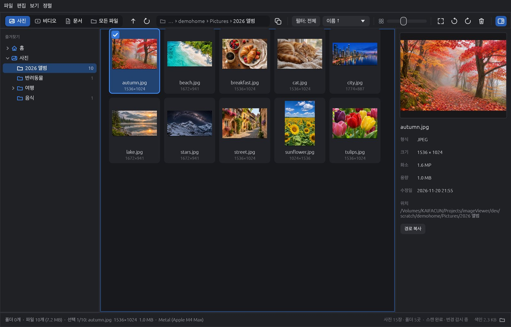
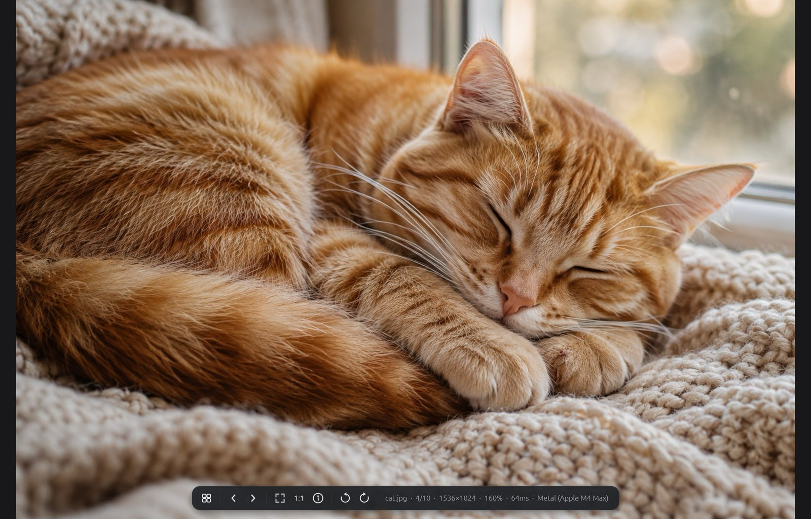
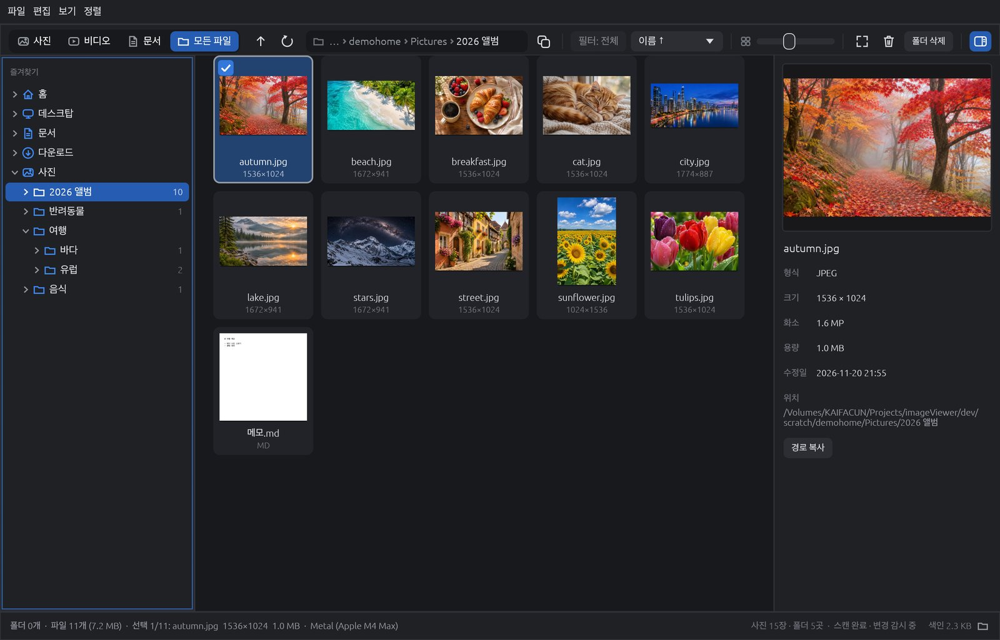
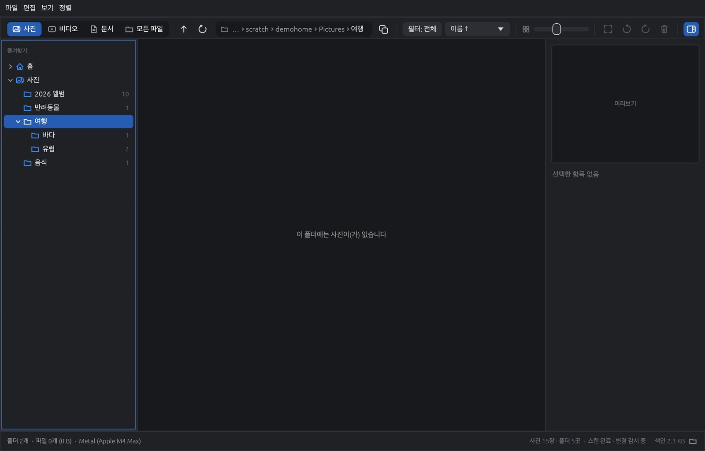

<p align="center"></p>

<h1 align="center">KaiIV</h1>

<p align="center"><b>빠르고 가벼운 맥용 이미지 뷰어</b> — 수천 장 폴더도 바로 훑고, 키보드만으로 넘기고, 정리까지.<br>
<sub>A fast, lightweight image viewer &amp; photo browser for macOS, written in Rust (GPU rendering with CPU fallback).</sub></p>

<p align="center">
  <a href="https://github.com/kaifacun/image-viewer/releases/latest"><b>⬇︎ 최신판 내려받기 (.dmg)</b></a> ·
  <a href="CHANGELOG.md">변경 기록</a> ·
  <a href="LICENSE">MIT 라이선스</a>
</p>

<p align="center"></p>

## 이런 앱입니다
- **빠름** — Rust + GPU(Metal) 렌더링. 다음 장은 미리 읽어 두어 넘기는 순간 바로 뜹니다. 썸네일은 디스크에 캐시해 다시 열면 즉시.
- **브라우저 + 전체 보기** — 왼쪽 폴더 트리, 가운데 썸네일 격자, 오른쪽 미리보기·정보. 더블클릭·Enter 로 전체 보기, Esc 로 돌아오면 마지막 장이 격자에 보입니다.
- **키보드로 전부** — Tab 으로 트리 ↔ 격자를 오가며 방향키로 폴더와 사진을 고릅니다.
- **사진 없는 폴더는 숨김** — 백그라운드 스캔이 하위까지 훑어 사진이 없는 폴더를 트리에서 감춥니다(펼친 폴더부터 먼저). 바뀐 폴더는 FSEvents 로 바로 반영.
- **정리** — 복사·잘라내기·붙여넣기(Finder 호환), 끌어다 폴더로 옮기기, 이름 바꾸기, 화질 손실 없는 회전 저장, 휴지통(되살리기 가능). 덮어쓰기는 하지 않습니다.
- **사진·비디오·문서** — HEIC·RAW 를 포함한 사진, 비디오 재생, PDF·마크다운·글 문서 보기. "모든 파일"을 켜면 폴더 안 모든 파일이 보이고 폴더 삭제까지.
- **어디서나 그려짐** — GPU 를 못 쓰면 CPU 렌더러로 같은 화면을 그립니다.

| 브라우저 | 전체 보기 |
|---|---|
|  |  |
| **모든 파일 켜기** (폴더 삭제 가능) | **폴더 트리 키보드 이동** |
|  |  |

<sub>화면의 시연 사진은 AI 로 생성한 이미지입니다.</sub>

## 설치 (macOS 12 이상, 애플 실리콘·인텔 겸용)
1. [Releases](https://github.com/kaifacun/image-viewer/releases/latest) 에서 `KaiIV-<버전>.dmg` 를 내려받아 엽니다.
2. `KaiIV` 를 `Applications` 폴더로 끌어다 놓습니다.
3. **처음 한 번만** — 이 앱은 Apple 공증(notarization)을 받지 않은 오픈 소스 앱이라 맥이 처음 실행을 막습니다.
   - 앱을 한 번 열어 경고가 뜨면 **시스템 설정 → 개인정보 보호 및 보안** 맨 아래 **"그래도 열기"** 를 누릅니다.
   - 또는 터미널에서: `xattr -dr com.apple.quarantine /Applications/KaiIV.app`

비디오의 일부 형식(MKV·AVI 등)은 필요할 때 무료 FFmpeg 를 받을지 묻습니다(동의해야만 설치).

## 조작 — 브라우저
| 입력 | 동작 |
|---|---|
| 클릭 / 더블클릭·Enter·Space | 선택 / 전체 보기 |
| ⌘+클릭, 썸네일 왼쪽 위 체크 상자 | 한 장씩 선택에 넣기·빼기 |
| ⇧+클릭, ⇧+화살표 | 범위 선택 |
| ⌘A | 모두 선택 |
| 빈 공간에서 끌기 (⌘/⇧ 누르면 더하기) / 빈 공간 클릭 | 선택 상자로 여러 장 / 선택 풀기 |
| F2, 썸네일 오른쪽 클릭 | 사진 이름 바꾸기 |
| ⇧⌘N, 트리 오른쪽 클릭 | 새 폴더 · 폴더 이름 바꾸기 |
| 썸네일을 왼쪽 폴더에 끌어다 놓기 | 그 폴더로 옮기기 (같은 이름이 있으면 건너뜀) |
| ⌘C / ⌘X / ⌘V, 오른쪽 클릭 | 복사 / 잘라내기 / 붙여넣기 (Finder 와 호환, 같은 이름은 "사본") |
| Option+⌘C, 주소 줄 오른쪽 버튼 | 선택한 사진의 절대 경로 복사 |
| 오른쪽 클릭·편집 메뉴·도구모음 회전 아이콘 | 선택한 사진 일괄 회전 (원본에 바로 저장, 화질 손실 없음) |
| ⌘⌫ / Delete, 도구모음 "휴지통" | 선택한 사진을 휴지통으로 (되돌리기 가능 — Finder 휴지통) |
| ← → ↑ ↓, PageUp/PageDown, Home/End | 격자 이동 |
| Tab, 창 클릭 | 키보드 초점을 폴더 트리 ↔ 격자로 (초점 있는 창에 파란 테두리) |
| (트리 초점) ↑ / ↓ · → / ← · Home/End · Enter | 폴더 이동(바로 열림) · 펼치기·하위 / 접기·상위 · 처음/끝 · 격자로 |
| ⌘1 / ⌘2 / ⌘3 | 사진 / 비디오 / 문서 보기 |
| ⌘4, 도구모음 "모든 파일" 체크 | 이 폴더의 다른 파일·빈 폴더도 보이기 켜기·끄기 (종류와 따로) |
| (모든 파일 켜짐) 도구모음 "폴더 삭제", 트리 오른쪽 클릭·⌫ | 폴더를 휴지통으로 — 안의 파일 수·용량 확인 창 뒤 |
| Backspace / ⌘R | 상위 폴더 / 새로고침 |
| 트리 클릭, ▶ | 폴더 열기, 펼치기 |
| 경로 줄에 입력 + Enter | 그 폴더로 |
| 도구모음 "크기" | 썸네일 크기 |
| 정렬 메뉴 | 이름·수정한 날짜·크기·형식, 오름/내림 |

## 조작 — 전체 보기
| 입력 | 동작 |
|---|---|
| → ↓ Space PageDown / ← ↑ Backspace PageUp | 다음 / 이전 |
| Home / End | 처음 / 끝 |
| + / - , 마우스 휠·트랙패드 스크롤, 트랙패드 핀치 | 확대·축소 (커서 기준) |
| 끌기 | 이동 (화면보다 클 때) |
| ⌘⌫ / Delete | 보고 있는 사진을 휴지통으로 |
| R / L(⇧R), 아래 "오른쪽 회전"·"왼쪽 회전" | 90° 돌리기 (화면만 — 다른 장·목록으로 가면 취소) |
| ⌘S, 아래 "저장" | 돌린 방향을 원본에 저장 — 방향 태그만 바꿔 화질 손실 없음 (JPEG·HEIC·PNG·TIFF) |
| 0 / 9 / 1 | 화면 맞춤 / 작은 이미지도 맞춤 / 원본 크기 |
| 더블클릭 | 맞춤 ↔ 1:1 |
| Esc | 브라우저로 (전체 화면이면 먼저 해제) |
| F, Enter | 전체 화면 |
| I | 정보 창 |
| 파일 끌어다 놓기 | 열기 |
| ⌘Q / ⌘W | 종료 |

## 사진 폴더 스캔
시작하면 트리 루트(홈·데스크탑·사진·다운로드·볼륨) 전부를 백그라운드에서 천천히 훑어(현재 사진 디코드에 양보), 하위 어디에도 사진이 없는 폴더를 트리에서 숨긴다. 진행 상황은 브라우저 상태줄 오른쪽. 첫 스캔 뒤엔 macOS FSEvents 로 바뀐 폴더만 다시 훑는다 — 사진을 넣거나 지우면 트리·열린 폴더가 저절로 맞춰진다. 링크 폴더·시스템 폴더·~/Library·네트워크 볼륨은 들어가지 않으며, 확신이 없는 폴더는 숨기지 않는다.

## 썸네일 캐시
`~/Library/Caches/KaiIV/thumbs-v1-320` (Windows `%LOCALAPPDATA%\KaiIV\cache`). 1GB 를 넘으면 시작 때 오래된 것부터 정리. `IV_CACHE_DIR` 로 위치 변경.

## 지원 형식
- macOS ImageIO: JPEG·PNG·GIF·TIFF·HEIC/HEIF·AVIF·WebP·JPEG 2000·PSD·EXR·HDR·카메라 RAW(DNG/CR2/CR3/NEF/ARW/RAF/ORF/RW2…)
- 순수 Rust(image-rs, 전 플랫폼 폴백): JPEG·PNG·GIF·WebP·BMP·TIFF·ICO·TGA·PNM·QOI
- ⚠️ 실제로 열어 시험한 것: JPEG·PNG·HEIC. RAW·AVIF·WebP·PSD·TIFF 는 등록만 되어 있고 실파일 시험 전. SVG·JXL 미지원.

## 렌더러
`--renderer=auto|gpu|fallback|cpu` — 기본 auto: GPU → 폴백 어댑터(WARP/llvmpipe) → CPU(softbuffer). 실행 중 장치 손실도 다음 단계로 전환하도록 되어 있으나 실제 장치 손실은 모의(`lost`)로만 시험. 현재 렌더러는 상태 표시줄에 표시. CPU 렌더러도 같은 화면(브라우저 포함)을 그린다.


## 소스에서 빌드
[Rust](https://rustup.rs) 가 필요합니다.
```bash
cargo run --release -p iv -- <폴더>        # 브라우저 화면 (인자 없으면 홈 폴더)
cargo run --release -p iv -- <파일>        # 그 사진 전체 보기로 시작 (Esc → 그 폴더 브라우저)
cargo run --release -p iv -- <폴더> --renderer=cpu      # CPU 렌더러 강제
tools/make-app.sh                  # dist/KaiIV.app
tools/make-app.sh --universal --dmg   # 애플 실리콘+인텔 겸용 .app + 배포용 .dmg
```
설계는 [docs/architecture.md](docs/architecture.md). 실행 파일 이름은 `kaiiv`, 내부 crate 는 `iv-*`.

## 시험
```bash
cargo test --workspace
python3 tools/make-fixtures.py scratch/fixtures         # 시험 이미지 생성 (git 제외)
cargo run --release -p iv -- scratch/fixtures/orient6.jpg --render-to=out.png --size=400x300 --renderer=cpu
cargo run --release -p iv-viewer --example nav_bench -- scratch/fixtures 300     # 넘기기 체감 시간
cargo run --release -p iv-decode-imageio --example decode_bench -- scratch/fixtures 2560
IV_SELFTEST="wait:1000;cap:/abs/a.png;act:next;wait:100;cap:/abs/b.png;quit" ./target/release/kaiiv scratch/fixtures
# 브라우저 자가 시험 (사용자 폴더·캐시를 건드리지 않게 scratch 로 고정)
IV_CACHE_DIR=$PWD/scratch/cache IV_TREE_ROOTS=$PWD/scratch \
IV_SELFTEST="wait-thumbs:8000;cap:/abs/b1.png;key:down;key:enter;wait:500;cap:/abs/b2.png;key:escape;dblclick:700,250;quit" \
  ./target/release/kaiiv scratch/many
```

## 라이선스
[MIT](LICENSE) © 2026 kaifacun
